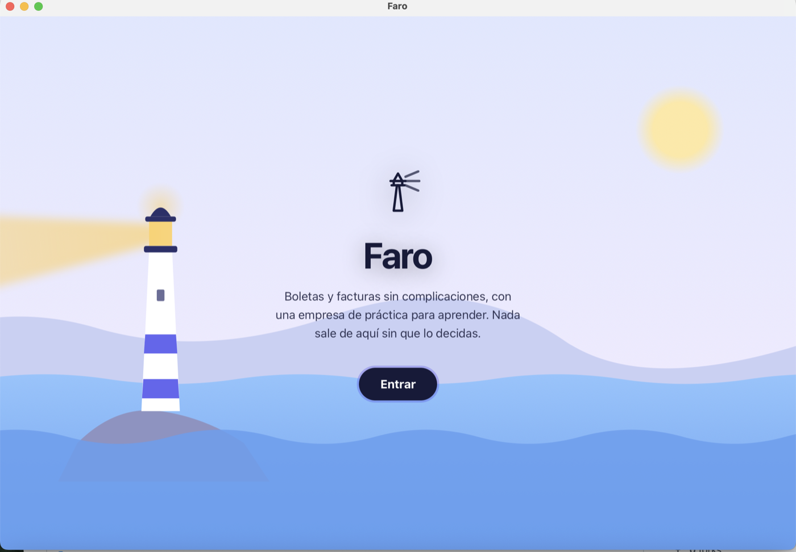

# 🧾 Faro DTE — boleta y factura electrónica gratis para el SII de Chile

> **Versión beta.** Faro ya emite documentos reales y aceptados por el SII, pero está en
> construcción: úsalo primero en la empresa de práctica, prueba con calma, y cuenta lo que
> falle en [Issues](https://github.com/SebastianMoyano/faro-dte/issues). Gratis y sin garantía (MIT).

**Faro** es un programa libre para **emitir boletas y facturas electrónicas en Chile** sin
pagar un proveedor: una app de escritorio pensada para aprender con una empresa de práctica y
después emitir de verdad con tu certificado digital, más un motor que corre en tu computador o
en tu servidor y un servidor MCP para que tu asistente de IA opere la facturación.

## Por qué existe

Lo hace **un emprendedor, jefe de TI en un colegio, para otros emprendedores**. Nació de una
constatación simple: facturar, declarar y entenderse con el SII es información difícil, escrita
para contadores, y esa dificultad es una barrera más para quien recién empieza. Faro quiere
**dar luz a esos temas complejos**: que cualquiera pueda trabajar dentro del sistema financiero
de Chile entendiendo lo que hace, sin compromisos con un proveedor y sin pagar por aprender.

La idea es **ir construyendo una base**, abierta y en español claro, donde cada concepto (la
boleta, el IVA, el folio, el F29, la nota de crédito) esté explicado y se pueda practicar con un
programa real antes de arriesgar un peso. Si eso baja la barrera para que un pequeño
emprendedor surja, cumplió.

> Antes se llamaba **DTE Chile**. El motor, los binarios y la API conservan sus nombres internos.
> Repositorio: [github.com/SebastianMoyano/faro-dte](https://github.com/SebastianMoyano/faro-dte).

**Qué hace, en corto**: tú pones tu certificado digital; Faro asigna el folio, timbra, firma,
arma el sobre, envía por el canal correcto, guarda el PDF y registra lo que el SII respondió.
Trae una empresa de práctica donde todo se forma, se firma y se timbra como un documento de
verdad, pero nunca sale del computador.

## Hacia dónde va

Faro empezó como un **servidor**: una API en Python con un panel web, pensada para que un
integrador o un contador la instalara en una máquina y la operara. Funcionó, y ahí se aprendió
cómo trabaja el SII de verdad. Pero un servidor no baja ninguna barrera: hay que saber
instalarlo, abrir un terminal, leer una documentación de API. Por eso el proyecto **está
migrando de servidor a app**: un programa que se descarga, se abre y guía, con una empresa de
práctica, un recorrido paso a paso y un botón "Muéstrame" que hace la acción por ti. La
facilidad de uso es ahora el criterio principal; el servidor y la API siguen existiendo
adentro, para quien los necesite.

Para que esa app funcione **en cualquier computador** (macOS, Windows, Linux) sin que la
persona instale Python ni nada más, el motor se reescribió dos veces: primero en **Go** y
después en **Rust**. Los tres motores producen **los mismos bytes**; Python sigue siendo la
referencia que fija el comportamiento, y cada port se midió contra ella con el corpus dorado y
el contrato de la API (203 de 203 respuestas idénticas). Hoy la app de Faro lleva el motor Rust
adentro, en el mismo proceso, en 14 MB.




> Pensado para **una persona que opera sus propias empresas**, no como servicio multi-cliente.

## Cómo funciona, en cuatro respuestas

Para leer de corrido. Cada encabezado dice lo esencial; el párrafo lo explica.

### 1. Hay dos caminos para emitir, y el primero es el del propio SII

- **El sistema gratuito del SII.** El SII ofrece en su página un emisor gratuito de facturas y
  uno de boletas. Faro no lo reemplaza: **lo opera por ti**, con tu sesión, igual que lo harías
  en el navegador, y le agrega lo que el SII no entrega: guarda el PDF y el XML de cada
  documento en tu computador, arma el resumen del mes y te muestra todo en la misma pantalla.
  Es el camino recomendado para quien recién empieza y no exige ningún trámite extra.
- **Tu propio motor.** Para quien emite mucho o integra sistemas: Faro mismo arma, timbra y
  firma el documento y lo envía al SII. Este camino **exige certificarse ante el SII**, un
  proceso que se hace una vez por empresa: el SII entrega un ambiente de pruebas, pide que se
  emita un set de documentos de muestra, los revisa, y recién entonces autoriza a emitir de
  verdad. Faro ya pasó ese proceso para la empresa de quien lo escribe, y trae las herramientas
  para pasarlo con la tuya ([`docs/CERTIFICACION.md`](docs/CERTIFICACION.md)). No es "conectarse
  a un servicio web": el SII es exigente con cada byte del documento, y eso es parte de lo que
  Faro ya resolvió.

### 2. Tus claves se quedan en tu computador

- **El certificado digital** se guarda **cifrado** en tu carpeta de datos, con una clave
  maestra que la app genera en tu computador la primera vez. Nunca sale de ahí y nunca se
  escribe en claro.
- **Un PIN es la llave de esa clave maestra.** La app te lo pide al guardar el primer
  certificado; desde ahí la clave maestra ya no está escrita en ninguna parte: se abre con tu
  PIN (Argon2id) al arrancar, se cierra sola si no usas la app durante un rato, y el primer
  envío real de cada sesión vuelve a pedirlo. Sin tu PIN, ni una copia completa de la carpeta
  sirve. Si lo olvidas no se recupera: se borran certificado y claves guardadas y los cargas de
  nuevo; los documentos emitidos se quedan.
- **La clave tributaria** (la del SII) solo hace falta para el camino del sistema gratuito,
  porque es la que abre la sesión en el portal. Se pide cuando se necesita, vive en memoria
  mientras la app está abierta y **se borra al cerrarla**, salvo que marques "recordar en este
  computador", en cuyo caso se guarda cifrada igual que el certificado.
- **La clave del certificado** se pide solo para firmar y no se guarda, salvo la misma opción
  de recordar.
- **Ninguna clave viaja a un servidor de Faro**, porque no existe tal servidor: todo corre en tu
  máquina, y lo único que sale es lo que va al SII.

### 3. La IA es opcional, y no emite nada sola

Si tienes un asistente de IA en tu computador (Claude, Cursor, VS Code, Gemini, Codex), Faro
puede conectarlo para que lea tus documentos, revise tus folios o te prepare una boleta. Pero
**la IA no tiene tus claves y no puede emitir por su cuenta**: todo lo que gasta folios o cuenta
ante el SII te lo muestra en la app y espera tu confirmación. Está apagada hasta que la
conectes en Ajustes, y la conexión es local, sin pasar por internet.

### 4. Antes de todo eso, practica

Faro trae una **empresa de práctica** donde cada boleta se arma, se timbra y se firma exactamente
como una real, pero nunca sale del computador. Ahí se aprende qué es un folio, el IVA, una
nota de crédito. Cuando quieras emitir de verdad, eliges una empresa real y el semáforo de la
app pasa a rojo: "esto cuenta".

## Qué es, en una tabla

| pieza | qué hace | dónde |
|---|---|---|
| **El motor** | el pipeline completo: folio → timbre (TED) → XML → firma → sobre → envío al SII → PDF → base | `nucleo-rs/` (Rust), `nucleo/` (Go) y `core/` + `main.py` (Python, la referencia) |
| **La app de escritorio (Faro)** | la interfaz para quien no sabe de finanzas: Inicio, Emitir, Documentos (con Mi mes y anular), Aprender, Ajustes; guía con "Muéstrame"; empresa de práctica | `app-rs/` (Tauri, motor Rust adentro) y `app/` (Wails, motor Go adentro); la misma interfaz en `app/frontend/dist` |
| **La API REST** | las 94 rutas con las que se integra cualquier sistema (POS, contabilidad, scripts) | `nucleo-rs/src/servidor`, `nucleo/servidor`, `api/` |
| **El servidor MCP** | 20 herramientas para que una IA (Claude, Cursor, VS Code, Gemini, Codex) opere la facturación, todo local | `nucleo-rs/src/mcp.rs`, `nucleo/mcp` |
| **Las herramientas del operador** | certificación ante el SII, folios (CAF), certificados, RVD, RCV/F29, portal del SII | `nucleo-rs/src/bin/nucleo-*`, `nucleo/cmd/nucleo-*` |
| **El corpus dorado y los gates** | cómo se sabe que funciona: 15 documentos byte a byte, contrato HTTP idéntico, vectores, auditoría pública | `tests/dorado/`, `tools/prueba_final.sh` |

El motor existe en **tres cuerpos que producen los mismos bytes**: Python + FastAPI, la
referencia donde se descubrió cómo funciona el SII; Go, un binario sin dependencias; y Rust, el
destino final, que corre dentro de la app de Faro. Cada port se midió, no se supuso:
[`docs/COMPARACION-PYTHON-GO.md`](docs/COMPARACION-PYTHON-GO.md) y
[`docs/PLAN-PORT.md`](docs/PLAN-PORT.md).

## Qué se hizo, y cuándo

- **Julio de 2026, el motor en Python.** Pipeline completo contra el SII y los 16 casos de la
  certificación. La lección más cara del proyecto: el SII rechazaba todo con `DTE-3-505`
  porque el DTE se firmaba ya embebido en el sobre; la firma correcta es *standalone* y el sobre
  se arma por strings con el DTE verbatim (`core/sobre.py`). Con eso llegaron las primeras
  aceptaciones reales: facturas en certificación, la certificación de boletas completa y una
  boleta real en producción. Todo con sus TrackID en
  [`docs/LECCIONES-SII.md`](docs/LECCIONES-SII.md).
- **Octubre de 2026, el port a Go.** Se escribió primero el corpus dorado (quince documentos con
  su salida esperada byte a byte) y después el núcleo en Go hasta reproducirlo: TED, firma,
  C14N, XSD, PDF417, sobre. El SII aceptó un documento emitido por el núcleo Go en
  certificación. Luego el resto: las rutas de la API con contrato idéntico al de Python, las
  boletas por REST, el RVD, el portal, el RCV/F29 y el canal del sistema del SII.
- **La app de escritorio** pasó de arrancar Python como proceso hijo a llevar el motor Go en el
  mismo proceso: 17 MB en vez de 219, y nada que instalar.
- **La IA como usuario.** Servidor MCP por stdio y por Streamable HTTP, con instaladores para
  siete clientes y un `.mcpb` de doble clic para la app de Claude. La pestaña "Tu IA" lo conecta
  sola.
- **Publicación 1.0 (11 de octubre de 2026).** Historia reescrita sin datos privados, auditoría
  automática que corre antes de cada push y en CI, licencia MIT, binarios para macOS, Linux y
  Windows en [Releases](https://github.com/SebastianMoyano/faro-dte/releases).
- **Octubre de 2026, el port a Rust y la app Faro.** El motor completo en Rust (`nucleo-rs/`),
  medido contra Python con el mismo corpus y el contrato de la API: 203 de 203 respuestas
  idénticas, 23 de 23 en el esquema de la base, 16 de 16 en el set de certificación. Encima, la
  app en Tauri con el motor Rust adentro. Y la interfaz se rehizo para que no sea un obstáculo:
  cuatro ítems, guía que respeta el "no", revisión antes de emitir, "Muéstrame", tema claro y
  oscuro, la entrada con el faro. El proyecto pasó a llamarse **Faro** y entró en **beta**.

## Cómo se ve

| | |
|---|---|
|  |  |
| **Emitir.** El recorrido explica cada campo (y "Muéstrame" lo hace por ti); ves neto, IVA y total antes de emitir. | **El documento.** La boleta de práctica, idéntica a una real: folio, detalle, totales y el timbre PDF417. |
|  |  |
| **Mi mes.** Cuánto vendiste, cuánto IVA cobraste y qué va a pedir el F29. | **Tu IA.** Un asistente del computador opera la facturación por MCP, sin claves que copiar. |


## Dos puertas

### 🎓 Quiero aprender

- **La app** trae una **empresa de práctica** y un tour que te lleva de cero a tu primera
  boleta, sin jerga. [`docs/APP.md`](docs/APP.md).
- **[`docs/INICIO-RAPIDO.md`](docs/INICIO-RAPIDO.md)** y el **[glosario](docs/GLOSARIO.md)**:
  qué es un folio, un CAF, un timbre, un TrackID, en dos líneas cada uno.
- **Aprender, dentro de la app**: una mini academia de 23 lecciones cortas (impuestos, IVA, UF y UTM, F29, tipos de empresa, plazos, folios y notas), recorridas paso a paso: primero adivinas, después lo ves y lo mueves en un visual, al final una pregunta y, si quieres, algo para hacer en la app. El mismo texto está en [`docs/aprender/LECCIONES.md`](docs/aprender/LECCIONES.md).
- **[`docs/aprender/`](docs/aprender/)**: el plan de lecciones por tramos, con quiz y videos.
- **[`docs/CONSTITUCION.md`](docs/CONSTITUCION.md)**: las leyes del motor. Cada una se pagó con
  días de trabajo o con folios reales; leerlas es la forma más rápida de aprender lo que el SII
  no documenta. Y [`docs/LECCIONES-SII.md`](docs/LECCIONES-SII.md), el diario de errores del SII
  y cómo se resolvieron.
- **El corpus dorado** ([`docs/DORADO.md`](docs/DORADO.md)): quince documentos con su salida
  esperada byte a byte. Sirve para verificar el motor, y sirve como ejercicio: reimplementa
  una parte en el lenguaje que quieras y mide si llegas al mismo byte. Así se portó a Go.

### 🧑‍💻 Quiero usarlo

| Cómo | Para quién |
|---|---|
| **Faro, la app de escritorio** (macOS hoy; Windows y Linux se construyen desde el mismo código; motor Rust adentro, sin instalar nada más) | quien factura desde su computador, y quien está aprendiendo |
| **Binario** `nucleo-servidor servir` en Rust o en Go (macOS, Linux, Windows; un archivo) | un servidor propio, una Raspberry, un VPS chico, o la sala de clases (sirve la misma interfaz en `/app`) |
| **Docker** con el motor Python (`docker-compose up -d`) | quien ya opera con contenedores |
| **Tu IA** (Claude Code, app de Claude, Cursor, VS Code, Windsurf, Gemini CLI, Codex): `nucleo-mcp instalar --en …` o la pestaña "Tu IA" de la app | operar la facturación conversando, todo local |

```bash
# La app (Tauri + motor Rust): cargo install tauri-cli, y
(cd app-rs && cargo tauri build --bundles app)    # app-rs/target/release/bundle/macos/Faro.app

# Un binario, sin Python (Rust o Go; o descarga el de Releases)
(cd nucleo-rs && cargo build --release --bin nucleo-servidor) && nucleo-rs/target/release/nucleo-servidor servir --puerto 8000
(cd nucleo && go build -o bin/nucleo-servidor ./cmd/nucleo-servidor) && nucleo/bin/nucleo-servidor servir --puerto 8000
# API en http://127.0.0.1:8000/api/v1, la misma interfaz de la app en /app

# Python (la referencia): Docker o venv
cp .env.example .env && docker-compose up -d    # Swagger en /docs
python -m venv .venv && source .venv/bin/activate && pip install -r requirements.txt
python setup.py && uvicorn main:app --reload --port 8000
```

Guías: [`docs/PLATAFORMA.md`](docs/PLATAFORMA.md) (API e integración),
[`docs/CONECTAR.md`](docs/CONECTAR.md) (tu IA), [`nucleo/README.md`](nucleo/README.md) (los
binarios), [`docs/CERTIFICACION.md`](docs/CERTIFICACION.md) (lo que el SII exige una vez antes
de emitir con software propio; el motor te guía).

## Qué hace

- **Emite factura y boleta** (33/34/39/41/52/56/61): folio → TED → firma → sobre → envío al SII → PDF → base.
- **Firma XMLDSig como el SII la acepta** (RSA-SHA1 + C14N; DTE firmado *standalone* e insertado *verbatim* en el sobre).
- **Envía por el canal correcto**: boletas por REST, facturas y el reporte diario de boletas (RVD) por DTEUpload; resolución de carátula por empresa y ambiente.
- **Repone folios solo** cuando bajan del umbral, y avisa por webhook.
- **Buscador público** `/consulta`, el "link de consulta" que exige el SII, con PDF y XML.
- **PDF con timbre PDF417** (carta y 80 mm térmico).
- **Trae lo emitido en el sistema del SII** y emite por él (facturas y notas de crédito) para empresas que todavía no tienen software propio.
- **Registro RCV y borrador del F29**: lo que vendiste, el IVA y lo que va a pedir el formulario.
- **Auth por JWT o API key**, keystore de certificados cifrado, rotación de claves, y un **servidor MCP** con 20 herramientas para una IA.

## Cómo se sabe que funciona

Cada pieza nace con su gate automático y todos corren de una vez, sin tocar al SII:

```bash
./tools/prueba_final.sh --sin-red
```

Corpus dorado (15 documentos byte a byte, en Python, Go y Rust), esquema de la base idéntico,
contrato HTTP idéntico entre los tres motores, vectores por paquete (validador XSD, PDF417,
portal, RCV, RVD, certificación), las dos apps arrancando su motor en proceso, el MCP conectado
de verdad a un cliente, y la auditoría pública (ni RUTs reales, ni personas, ni secretos, en el
árbol ni en la historia). El mismo workflow corre en GitHub Actions y un hook lo exige antes
de cada push. Contra el SII vivo: facturas, boletas y notas de crédito aceptadas en
certificación y en producción, con sus TrackID en
[`docs/LECCIONES-SII.md`](docs/LECCIONES-SII.md).

**Lo que todavía no se verificó desde Go ni desde Rust contra el SII vivo** (los dos reproducen
byte a byte las evidencias aceptadas por Python, pero aún no tienen su propio TrackID en estos
canales): el reporte diario de boletas (RVD), una boleta por REST y una factura por el sistema
del SII. Los comandos están en [`docs/PLAN-PORT.md`](docs/PLAN-PORT.md). Esto, y que la app
recién tuvo su rediseño, es lo que hace que Faro sea **beta**.

## Requisitos

- Un **certificado digital** de persona natural (`.p12`/`.pfx`), el mismo con que entras al SII.
- Una empresa con **inicio de actividades** en primera categoría.
- Para emitir con software propio, el SII exige **certificarse** una vez.

## Autenticación y seguridad

Todo se autentica con `Authorization: Bearer <token>`: **JWT** para la gestión (admin creado
al primer arranque con clave impresa una vez) o **API key** para integraciones (`/apikeys`,
no expira, en la base solo va su hash). Los certificados se cifran en la base y se usan en
memoria. Lo único público es `/consulta`. Qué nunca entra al repo y cómo reportar un problema:
[`SECURITY.md`](SECURITY.md).

## Preguntas típicas

- **¿El voucher de la tarjeta ya cuenta como boleta?** Depende de tu "modelo de emisión", y si
  no declaras nada el SII asume que sí: [`docs/MODELO-EMISION.md`](docs/MODELO-EMISION.md).
- **¿Cómo anulo una boleta?** No se borra: se anula con una nota de crédito.
  [`docs/ANULAR-BOLETA.md`](docs/ANULAR-BOLETA.md).
- **"Debe ingresar con la persona autorizada"…** Entraste con la identidad equivocada (empresa,
  persona o representante): [`docs/IDENTIDADES-SII.md`](docs/IDENTIDADES-SII.md).

## Documentación

[`docs/MAPA.md`](docs/MAPA.md) es el índice de todo. Para contribuir:
[`CONTRIBUTING.md`](CONTRIBUTING.md).

## Licencia

**Copyright © 2026 Extralatte.** Distribuido bajo la **licencia MIT**, ver [`LICENSE`](LICENSE).

En palabras simples: **es gratis.** Puedes usarlo, modificarlo, integrarlo en tu producto y
cobrar por él, sin pedir permiso y sin obligación de publicar tus cambios. La única condición es
conservar el aviso de licencia. Si arreglas algo, un *pull request* ayuda a todos los que
facturan en Chile.

**Sin garantía y sin responsabilidad.** Este motor emite documentos tributarios reales. Se
entrega tal cual: **quien lo opera es responsable de lo que emite, declara o envía al SII**, de
verificar los resultados y de cumplir sus obligaciones tributarias. Los autores no responden por
folios perdidos, documentos rechazados, multas ni cualquier otro daño derivado de su uso.

> Las versiones publicadas antes de octubre de 2026 se distribuyeron bajo AGPL-3.0; desde la
> 1.0.0 la licencia es MIT.

## Créditos

El formato de documentos, sobres y reportes se implementó desde las **especificaciones
oficiales del SII** (XSD, instructivos, resoluciones). Se consultó
[**LibreDTE**](https://www.libredte.cl) (© SASCO SpA, AGPL-3.0) como referencia del
comportamiento correcto del SII en varios puntos; este proyecto es una implementación
independiente y no incluye su código.
