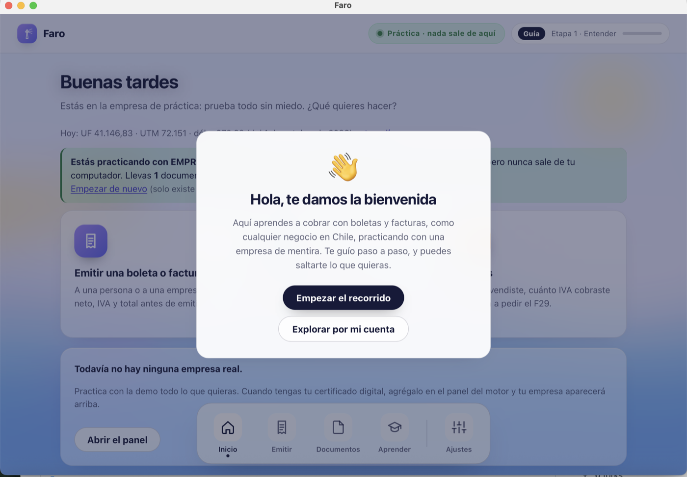
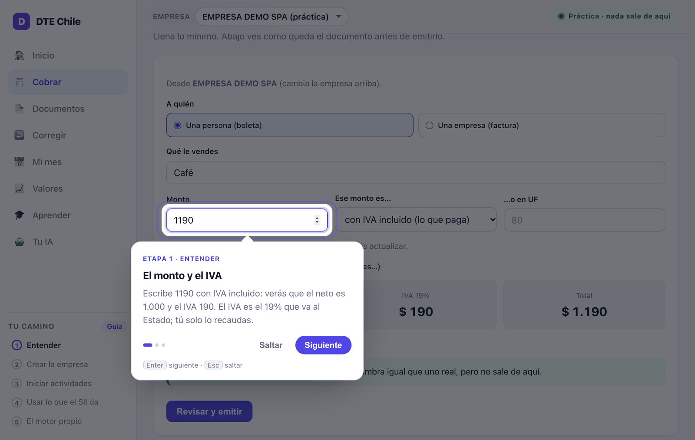
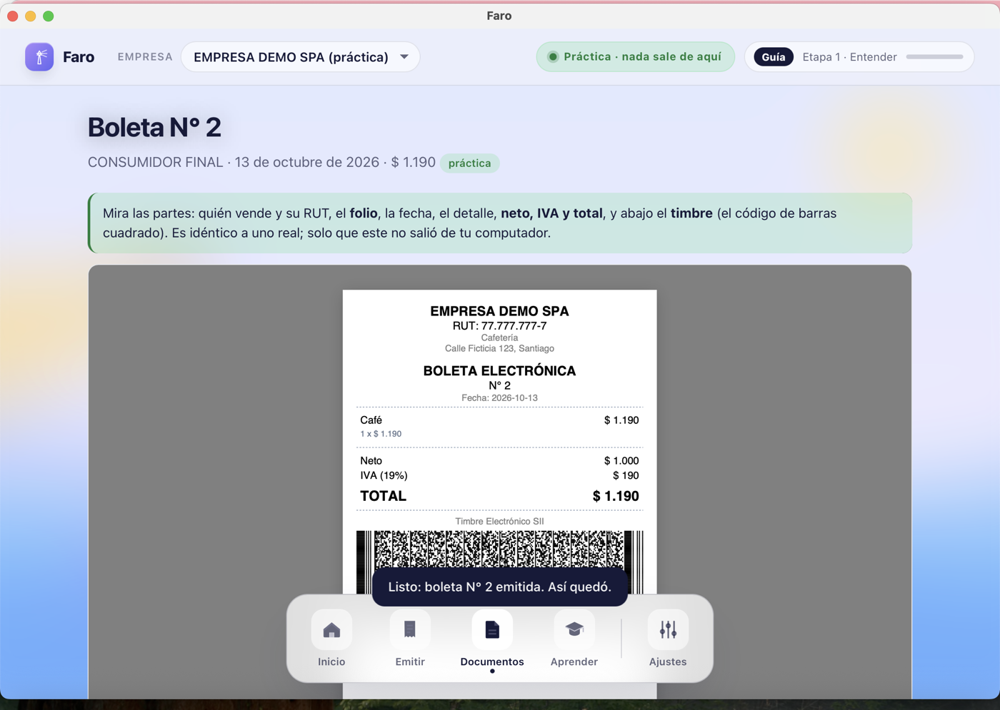
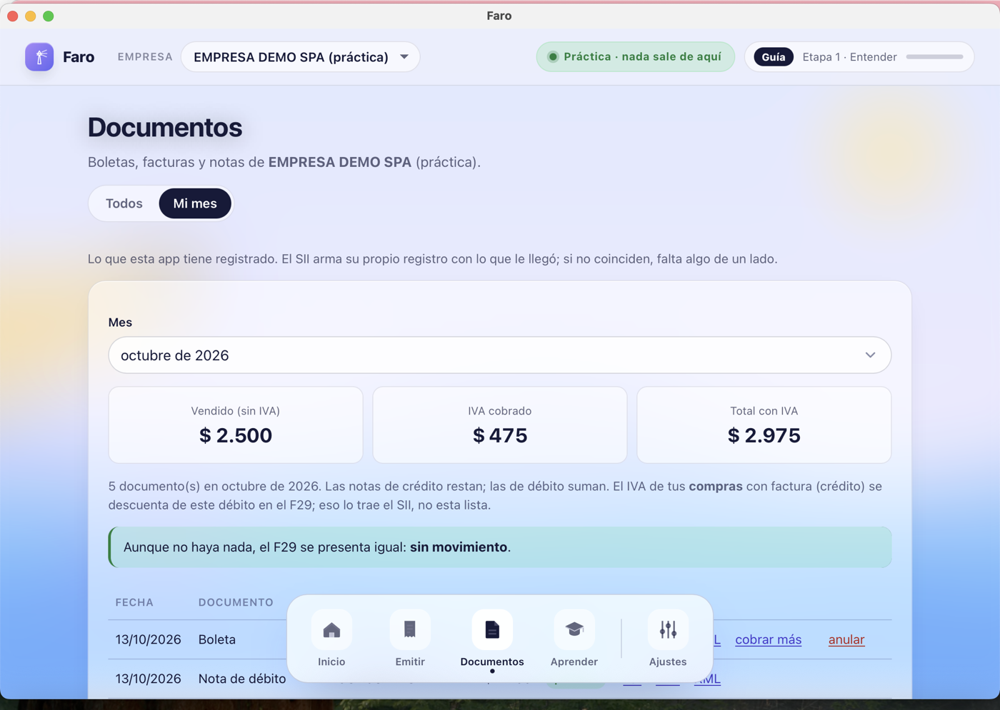
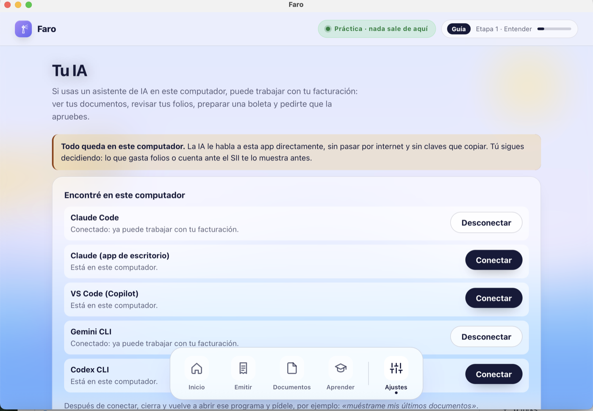
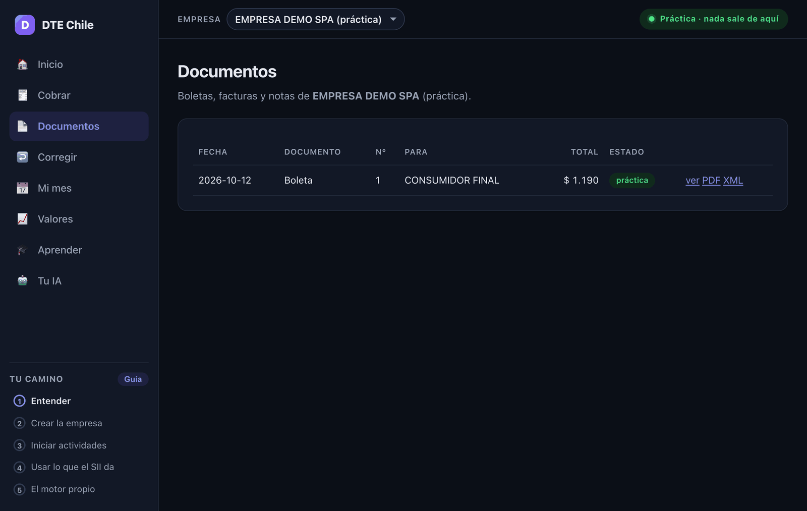

# 🧾 Faro — facturación electrónica para el SII, libre y para aprender

> Antes se llamaba **DTE Chile**. El motor, los binarios y la API conservan sus nombres internos.

**Un programa que emite boletas y facturas electrónicas directo con el SII de Chile**, desde
tu computador o tu servidor, sin pagar un proveedor. Tú pones tu certificado digital; él asigna
el folio, timbra, firma, arma el sobre, envía por el canal correcto, guarda el PDF y registra
lo que el SII respondió. Licencia **MIT**: gratis, sin garantía.

Nació para **enseñar** facturación electrónica a alumnos de colegio con un programa real, y
se nota: trae una empresa de práctica donde todo se forma, se firma y se timbra como un
documento de verdad, pero nunca sale del computador.



> Pensado para **una persona que opera sus propias empresas**, no como servicio multi-cliente.

## Qué es, en una tabla

| pieza | qué hace | dónde |
|---|---|---|
| **El motor** | el pipeline completo: folio → timbre (TED) → XML → firma → sobre → envío al SII → PDF → base | `nucleo/` (Go) y `core/` + `main.py` (Python) |
| **La app de escritorio** | la interfaz para quien no sabe de finanzas: cobrar, ver documentos, corregir, "Mi mes", aprender | `app/` (Go + Wails, con el motor adentro) |
| **La API REST** | las 94 rutas con las que se integra cualquier sistema (POS, contabilidad, scripts) | `nucleo/servidor`, `api/` |
| **El servidor MCP** | 20 herramientas para que una IA (Claude, Cursor, VS Code, Gemini, Codex) opere la facturación, todo local | `nucleo/mcp` |
| **Las herramientas del operador** | certificación ante el SII, folios (CAF), certificados, RVD, RCV/F29, portal del SII | `nucleo/cmd/nucleo-*` |
| **El corpus dorado y los gates** | cómo se sabe que funciona: 15 documentos byte a byte, contrato HTTP idéntico, vectores, auditoría pública | `tests/dorado/`, `tools/prueba_final.sh` |

El motor existe en **dos cuerpos que producen los mismos bytes**: Python + FastAPI, la
referencia donde se descubrió cómo funciona el SII, y Go, un binario sin dependencias que corre
dentro de la app y en cualquier servidor. El port se midió, no se supuso:
[`docs/COMPARACION-PYTHON-GO.md`](docs/COMPARACION-PYTHON-GO.md).

## Qué se hizo, y cuándo

- **Julio de 2026, el motor en Python.** Pipeline completo contra el SII y los 16 casos de la
  certificación. La lección más cara del proyecto: el SII rechazaba todo con `DTE-3-505`
  porque el DTE se firmaba ya embebido en el sobre; la firma correcta es *standalone* y el sobre
  se arma por strings con el DTE verbatim (`core/sobre.py`). Con eso llegaron las primeras
  aceptaciones reales: facturas en certificación, la certificación de boletas completa y una
  boleta real en producción. Todo con sus TrackID en
  [`docs/LECCIONES-SII.md`](docs/LECCIONES-SII.md).
- **Octubre de 2026, el port a Go.** Se escribió primero el corpus dorado (quince documentos con
  su salida esperada byte a byte) y después el núcleo en Go hasta reproducirlo: TED, firma,
  C14N, XSD, PDF417, sobre. El SII aceptó un documento emitido por el núcleo Go en
  certificación. Luego el resto: las rutas de la API con contrato idéntico al de Python, las
  boletas por REST, el RVD, el portal, el RCV/F29 y el canal del sistema del SII.
- **La app de escritorio** pasó de arrancar Python como proceso hijo a llevar el motor Go en el
  mismo proceso: 17 MB en vez de 219, y nada que instalar.
- **La IA como usuario.** Servidor MCP por stdio y por Streamable HTTP, con instaladores para
  siete clientes y un `.mcpb` de doble clic para la app de Claude. La pestaña "Tu IA" lo conecta
  sola.
- **Publicación 1.0 (11 de octubre de 2026).** Historia reescrita sin datos privados, auditoría
  automática que corre antes de cada push y en CI, licencia MIT, binarios para macOS, Linux y
  Windows en [Releases](https://github.com/SebastianMoyano/faro-edu/releases).

## Cómo se ve

| | |
|---|---|
|  |  |
| **Cobrar.** El recorrido explica cada campo; abajo ves neto, IVA y total antes de emitir. | **El documento.** La boleta de práctica, idéntica a una real: folio, detalle, totales y el timbre PDF417. |
|  |  |
| **Mi mes.** Cuánto vendiste, cuánto IVA cobraste y qué va a pedir el F29. | **Tu IA.** Un asistente del computador opera la facturación por MCP, sin claves que copiar. |



## Dos puertas

### 🎓 Quiero aprender

- **La app** trae una **empresa de práctica** y un tour que te lleva de cero a tu primera
  boleta, sin jerga. [`docs/APP.md`](docs/APP.md).
- **[`docs/INICIO-RAPIDO.md`](docs/INICIO-RAPIDO.md)** y el **[glosario](docs/GLOSARIO.md)**:
  qué es un folio, un CAF, un timbre, un TrackID, en dos líneas cada uno.
- **[`docs/aprender/`](docs/aprender/)**: el plan de lecciones por tramos, con quiz y videos.
- **[`docs/CONSTITUCION.md`](docs/CONSTITUCION.md)**: las leyes del motor. Cada una se pagó con
  días de trabajo o con folios reales; leerlas es la forma más rápida de aprender lo que el SII
  no documenta. Y [`docs/LECCIONES-SII.md`](docs/LECCIONES-SII.md), el diario de errores del SII
  y cómo se resolvieron.
- **El corpus dorado** ([`docs/DORADO.md`](docs/DORADO.md)): quince documentos con su salida
  esperada byte a byte. Sirve para verificar el motor, y sirve como ejercicio: reimplementa
  una parte en el lenguaje que quieras y mide si llegas al mismo byte. Así se portó a Go.

### 🧑‍💻 Quiero usarlo

| Cómo | Para quién |
|---|---|
| **App de escritorio** (macOS; motor Go adentro, sin instalar nada más) | quien factura desde su computador |
| **Binario Go** `nucleo-servidor servir` (macOS, Linux, Windows; un archivo) | un servidor propio, una Raspberry, un VPS chico |
| **Docker** con el motor Python (`docker-compose up -d`) | quien ya opera con contenedores |
| **Tu IA** (Claude Code, app de Claude, Cursor, VS Code, Windsurf, Gemini CLI, Codex): `nucleo-mcp instalar --en …` o la pestaña "Tu IA" de la app | operar la facturación conversando, todo local |

```bash
# Go: un binario, sin Python (o descarga el de Releases)
cd nucleo && go build -o bin/nucleo-servidor ./cmd/nucleo-servidor
bin/nucleo-servidor servir --puerto 8000        # API en http://127.0.0.1:8000/api/v1, interfaz en /app

# Python (la referencia): Docker o venv
cp .env.example .env && docker-compose up -d    # Swagger en /docs
python -m venv .venv && source .venv/bin/activate && pip install -r requirements.txt
python setup.py && uvicorn main:app --reload --port 8000
```

Guías: [`docs/PLATAFORMA.md`](docs/PLATAFORMA.md) (API e integración),
[`docs/CONECTAR.md`](docs/CONECTAR.md) (tu IA), [`nucleo/README.md`](nucleo/README.md) (los
binarios), [`docs/CERTIFICACION.md`](docs/CERTIFICACION.md) (lo que el SII exige una vez antes
de emitir con software propio; el motor te guía).

## Qué hace

- **Emite factura y boleta** (33/34/39/41/52/56/61): folio → TED → firma → sobre → envío al SII → PDF → base.
- **Firma XMLDSig como el SII la acepta** (RSA-SHA1 + C14N; DTE firmado *standalone* e insertado *verbatim* en el sobre).
- **Envía por el canal correcto**: boletas por REST, facturas y el reporte diario de boletas (RVD) por DTEUpload; resolución de carátula por empresa y ambiente.
- **Repone folios solo** cuando bajan del umbral, y avisa por webhook.
- **Buscador público** `/consulta`, el "link de consulta" que exige el SII, con PDF y XML.
- **PDF con timbre PDF417** (carta y 80 mm térmico).
- **Trae lo emitido en el sistema del SII** y emite por él (facturas y notas de crédito) para empresas que todavía no tienen software propio.
- **Registro RCV y borrador del F29**: lo que vendiste, el IVA y lo que va a pedir el formulario.
- **Auth por JWT o API key**, keystore de certificados cifrado, rotación de claves, y un **servidor MCP** con 20 herramientas para una IA.

## Cómo se sabe que funciona

Cada pieza nace con su gate automático y todos corren de una vez, sin tocar al SII:

```bash
./tools/prueba_final.sh --sin-red
```

Corpus dorado (15 documentos byte a byte, en Python y en Go), esquema de la base idéntico,
contrato HTTP idéntico entre los dos motores, vectores por paquete (validador XSD, PDF417,
portal, RCV, RVD, certificación), la app arrancando el motor en proceso, el MCP conectado de
verdad a un cliente, y la auditoría pública (ni RUTs reales, ni personas, ni secretos, en el
árbol ni en la historia). El mismo workflow corre en GitHub Actions y un hook lo exige antes
de cada push. Contra el SII vivo: facturas, boletas y notas de crédito aceptadas en
certificación y en producción, con sus TrackID en
[`docs/LECCIONES-SII.md`](docs/LECCIONES-SII.md).

**Lo que todavía no se verificó desde Go contra el SII vivo** (Go reproduce byte a byte las
evidencias aceptadas por Python, pero aún no tiene su propio TrackID en estos canales): el
reporte diario de boletas (RVD), una boleta por REST y una factura por el sistema del SII. Los
comandos están en [`docs/PLAN-PORT.md`](docs/PLAN-PORT.md).

## Requisitos

- Un **certificado digital** de persona natural (`.p12`/`.pfx`), el mismo con que entras al SII.
- Una empresa con **inicio de actividades** en primera categoría.
- Para emitir con software propio, el SII exige **certificarse** una vez.

## Autenticación y seguridad

Todo se autentica con `Authorization: Bearer <token>`: **JWT** para la gestión (admin creado
al primer arranque con clave impresa una vez) o **API key** para integraciones (`/apikeys`,
no expira, en la base solo va su hash). Los certificados se cifran en la base y se usan en
memoria. Lo único público es `/consulta`. Qué nunca entra al repo y cómo reportar un problema:
[`SECURITY.md`](SECURITY.md).

## Preguntas típicas

- **¿El voucher de la tarjeta ya cuenta como boleta?** Depende de tu "modelo de emisión", y si
  no declaras nada el SII asume que sí: [`docs/MODELO-EMISION.md`](docs/MODELO-EMISION.md).
- **¿Cómo anulo una boleta?** No se borra: se anula con una nota de crédito.
  [`docs/ANULAR-BOLETA.md`](docs/ANULAR-BOLETA.md).
- **"Debe ingresar con la persona autorizada"…** Entraste con la identidad equivocada (empresa,
  persona o representante): [`docs/IDENTIDADES-SII.md`](docs/IDENTIDADES-SII.md).

## Documentación

[`docs/MAPA.md`](docs/MAPA.md) es el índice de todo. Para contribuir:
[`CONTRIBUTING.md`](CONTRIBUTING.md).

## Licencia

**Copyright © 2026 Extralatte.** Distribuido bajo la **licencia MIT**, ver [`LICENSE`](LICENSE).

En palabras simples: **es gratis.** Puedes usarlo, modificarlo, integrarlo en tu producto y
cobrar por él, sin pedir permiso y sin obligación de publicar tus cambios. La única condición es
conservar el aviso de licencia. Si arreglas algo, un *pull request* ayuda a todos los que
facturan en Chile.

**Sin garantía y sin responsabilidad.** Este motor emite documentos tributarios reales. Se
entrega tal cual: **quien lo opera es responsable de lo que emite, declara o envía al SII**, de
verificar los resultados y de cumplir sus obligaciones tributarias. Los autores no responden por
folios perdidos, documentos rechazados, multas ni cualquier otro daño derivado de su uso.

> Las versiones publicadas antes de octubre de 2026 se distribuyeron bajo AGPL-3.0; desde la
> 1.0.0 la licencia es MIT.

## Créditos

El formato de documentos, sobres y reportes se implementó desde las **especificaciones
oficiales del SII** (XSD, instructivos, resoluciones). Se consultó
[**LibreDTE**](https://www.libredte.cl) (© SASCO SpA, AGPL-3.0) como referencia del
comportamiento correcto del SII en varios puntos; este proyecto es una implementación
independiente y no incluye su código.
